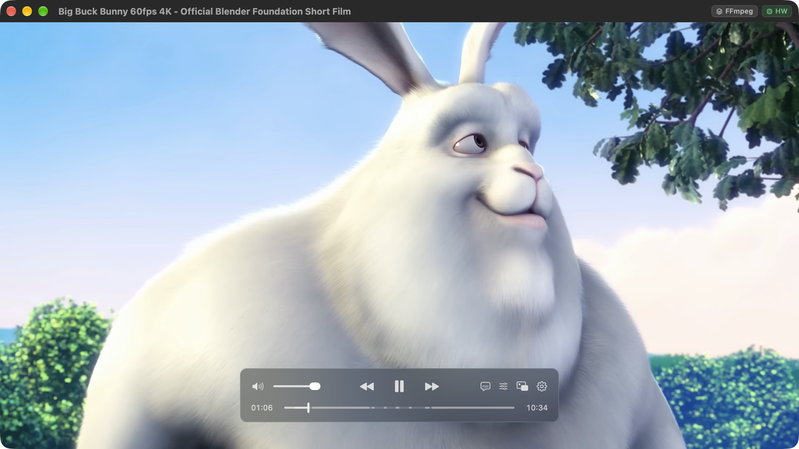

# LightPlayer

A low-RAM, hardware-accelerated video player for macOS 27+ on Apple silicon.




## Build

```bash
brew install ffmpeg xcodegen   # mpv only needed for the LightBench target
Bench/build.sh                 # builds build/Build/Products/Release/LightPlayer.app
SCHEME=LightBench Bench/build.sh
```

## Architecture

| Source | Engine | Why |
|---|---|---|
| Local MP4 / M4V / MOV | `AVPlayerEngine` — AVFoundation (QuickTime's stack) | Leanest index memory for long MP4s |
| Everything else (MKV, WebM, TS, AVI…) and **all** network streams | `SampleBufferEngine` — libavformat demux only → `AVSampleBufferDisplayLayer` / `AVSampleBufferAudioRenderer` | VideoToolbox/Core Audio decode; same RAM as AVPlayer; disk-backed stream buffer |

- No decoded pixels ever touch app memory; compressed packets are copied into a `CMMemoryPool` and freed immediately.
- Streams go through `CachedHTTPSource`: ranged HTTP downloads into a sparse temp file (default 10 min read-ahead, Basic auth from URL), so the buffer lives on disk, not RAM.
- Brightness / contrast / gamma are Core Image layer filters, attached only when non-default (HDR is shown as SDR while a filter is active).
- Subtitles: SRT / WebVTT / mov_text / ASS-as-text and PGS / VobSub / DVB bitmaps, embedded or sidecar; hidden by default unless a forced track exists (MKV disposition, ffmpeg's MP4 `udta/kind` "forced-subtitle" box, or Apple's tx3g forced display flags).
- Software fallbacks (only when there is no hardware/system decoder): DTS / DTS-HD MA (lossless by default), TrueHD, Vorbis, WMA → FFmpeg → Float32 PCM; AV1 on M1/M2 → dav1d → pooled IOSurface NV12/P010 buffers; VP8/VC-1/etc. → FFmpeg. Decoding happens only when the renderer asks for data, so decoded frames never pile up.

| Fallback (M2) | App RAM | CPU |
|---|---|---|
| AV1 1080p30, dav1d (`max_frame_delay` 1) | 72 MB | 23% |
| AV1 1080p30, dav1d (delay 2 / auto) | 100–109 MB | 32–33% |
| DTS-HD MA 5.1 lossless on 4K HEVC remux | 52 MB (+207 MB decoder process) | ~8% total, decode itself barely shows in samples |

## Benchmark (M2, 1280×720 window, app + VTDecoderXPCService footprint)

| Clip | A AVPlayer | C FFdemux+AVSBDL | D libmpv |
|---|---|---|---|
| 1080p H.264 MP4 | 103 MB · 9% CPU | 102 MB · 9% | 339 MB · 30% |
| 4K HDR HEVC MP4 | 252 MB · 6% | 252 MB · 6% | 876 MB · 19% |
| 4K HDR HEVC MKV | — | 240 MB · 7% | 877 MB · 19% |
| 4K remux MKV 9 GB (DTS) | — | 235 MB · 5% | 1055 MB · 17% |
| 1080p MP4, 4.5 h, 15 GB | **136 MB** | 192 MB | 438 MB |
| Remote HTTPS 1080p MKV | — | 80 MB · 6% | 331 MB · 18% |

Engine B (AVPlayer + our Matroska MediaExtension in `Sources/MKVReader`) is implemented but can't run here:
format-reader extensions need the `com.apple.developer.mediaextension.formatreader` entitlement, which requires a paid
Apple Developer Program team (without it MediaExtension refuses the reader; with it but no profile, AMFI kills it).
[QuickLookVideo](https://github.com/Marginal/QuickLookVideo) does the same thing with a paid team: an FFmpeg-based
format reader extension plus an `MEVideoDecoder` extension for non-native codecs, shipped as a signed DMG. With either
installed and enabled, engine B costs ≈ A + one extension process, so it can't beat C.

Re-run: `Bench/run_bench.py --seconds 40` (remote URL read from `Bench/.remote_url`, not committed).
