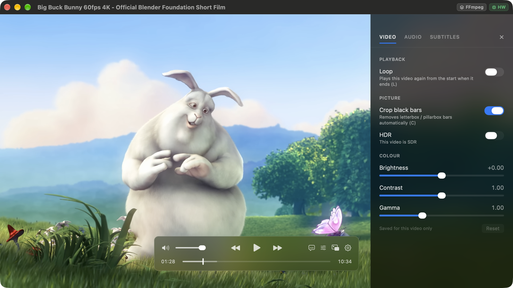

# LightPlayer

A low-RAM, hardware-accelerated video player for macOS 27+ on Apple silicon.


 

<sub>Screenshots show [Big Buck Bunny](https://peach.blender.org/) (© 2008 Blender Foundation, [CC BY 3.0](https://creativecommons.org/licenses/by/3.0/)), streamed from Blender's official YouTube upload.</sub>

Press **⌘I** for the inspector: pipeline, decoder actually in use (VideoToolbox hardware / software, dav1d, FFmpeg audio, or a Media Extension), colour/HDR, tracks, file info and live status (buffer, disk cache, download speed, memory, CPU, display EDR headroom).

## Build

```bash
brew install ffmpeg xcodegen   # mpv only needed for the LightBench target
Bench/build.sh                 # builds build/Build/Products/Release/LightPlayer.app
SCHEME=LightBench Bench/build.sh
```

## Architecture

| Source | Engine | Why |
|---|---|---|
| Local MP4 / M4V / MOV | `AVPlayerEngine` — AVFoundation (QuickTime's stack) | Leanest index memory for long MP4s |
| Everything else (MKV, WebM, TS, AVI…) and **all** network streams | `SampleBufferEngine` — libavformat demux only → `AVSampleBufferDisplayLayer` / `AVSampleBufferAudioRenderer` | VideoToolbox/Core Audio decode; same RAM as AVPlayer; disk-backed stream buffer |

- No decoded pixels ever touch app memory; compressed packets are copied into a `CMMemoryPool` and freed immediately.
- Streams go through `CachedHTTPSource`: ranged HTTP downloads into a sparse temp file (default 10 min read-ahead, Basic auth from URL), so the buffer lives on disk, not RAM.
- Brightness / contrast / gamma are Core Image layer filters, attached only when non-default (HDR is shown as SDR while a filter is active).
- Subtitles: SRT / WebVTT / mov_text / ASS-as-text and PGS / VobSub / DVB bitmaps, embedded or sidecar; hidden by default unless a forced track exists (MKV disposition, ffmpeg's MP4 `udta/kind` "forced-subtitle" box, or Apple's tx3g forced display flags).
- In-app hardware decoding (engine C): compressed H.264/HEVC/VP9 go through our own pipelined `VTDecompressionSession` (`HWVideoDecoder`, 4 frames look-ahead + reorder window) and the display layer only presents finished frames. Measured on screen on the 4K HDR10 Blu-ray remux (4K HDR10, 50 Mbps, 8-deep B-pyramids): letting AVSampleBufferDisplayLayer decode internally showed only 194–222 distinct frames per 12 s (it silently repeats ~25–35% of frames, while its own metrics report ~no drops) — that was the "jitter" IINA doesn't have. With in-app decoding: 299–301 distinct frames (all of them), a clean 2-3 cadence. Cost: ~+17 MB total. `LP_LAYER_DECODE=1` reverts; `LP_VIDEO_METRICS=1` logs the renderer's counters (also in the inspector).
- Unindexed fragmented MP4 (Twitch/live-stream downloads: `moov` + ~165k tiny `moof`/`mdat` pairs, no `sidx`/`mfra`): AVFoundation and libavformat both walk every fragment header before playing — 19.8 s (AVPlayer) / 28.9 s (FFmpeg) cold for a 13 GB 3.8 h VOD. `FragmentedMP4` detects these (~5 ms), they go to engine C, libavformat opens with `ignidx`, duration comes from the last fragment, and seeks binary-search fragment `tfdt` times by byte offset then re-open the demuxer on a spliced header+fragment view. Now 0.2–0.26 s to first frame (incl. resume seek), 3–8 ms per seek, no index kept in memory.
- Streams: the seek bar shows downloaded ranges as a lighter band (IINA-style). When the demuxer is starved (a read waits on the network) the clock is held and a centred "Buffering… N% · speed" HUD shows; playback resumes once ~3 s of data is buffered ahead or the download is complete (mpv's cache-pause idea). `LP_NET_THROTTLE=<KB/s>` caps bandwidth to reproduce it; `LP_BUFFER_DEBUG=1` logs the decisions.
- Brightness / contrast / gamma are remembered per file (other files start neutral); the sliders edit the front window's file.
- Several videos at once (like IINA): opening a file when the front player has a video opens a new, offset window; closing the last window leaves the app running (Dock icon → Welcome window). Welcome window is resizable and remembers its size.
- Trackpad pinch resizes the player window (keeps the aspect, stays on screen); controls and title bar hide as soon as the pointer leaves a playing window.
- YouTube and Twitch links (Open URL, web links, command line) are resolved with yt-dlp (`brew install yt-dlp`): Twitch / live → HLS via AVPlayer; YouTube's separate high-quality files (VP9 ≤1440p or H.264 ≤1080p + stereo AAC) → the FFmpeg engine with two inputs (AVFoundation stalls on them). Buffering holds the clock until both inputs have ~3 s ahead. History keeps the page link, so reopening resolves fresh stream URLs.
- Loop: Playback › Loop (⌘L), the L key or the sidebar switch replays the video from the start when it ends. Without loop the player stops on the last frame, paused, with the controls shown; Space plays it again from the start.
- Settings sidebar (like IINA): the control bar's sliders button or View › Video, Audio & Subtitle Settings (⌃⌘S) slides a dark panel in from the right with **Video** (loop, crop black bars, HDR (off and greyed out for SDR videos), brightness / contrast / gamma saved per file), **Audio** (track picker) and **Subtitles** (track picker, load a subtitle file) tabs. Click the video, press Esc or the button again to close it.
- Auto-crop: shapes count only once two samples agree; the crop is the union of confirmed shapes (it only grows, so a film that opens with a small framed "home video" intro still ends up letterbox-cropped); windowboxes need three samples over ≥45 s; remembered crops keep being re-checked. Quick off switches: View › Crop Black Bars (C), the sidebar, and the title bar's Crop tag ("Don't Crop This Video").
- Title bar tags (hover for a details panel that stays open while hovered; also shows audio decoding): the playback engine (**FFmpeg** / **AVFoundation**; hover for the full pipeline), **HW** / **SW** (hover: codec and decoder — VideoToolbox media engine, dav1d, FFmpeg) and the HDR format (**HDR10**, **Dolby Vision**, **HLG**; "→ SDR" when HDR output is off). Long titles are middle-truncated so they stay clear of the tags.
- Welcome window (like IINA's start window): icon, version, Open… / Open URL…, and the last 9 played items (click to resume, drop a file on it). Shown at launch and when the last player closes.
- Playback history (File › Playback History, ⇧⌘H): table of everything played with IINA-style progress bars and position, grouped by date or folder, searchable, double-click to resume, right-click Open / Show in Finder / Remove, Delete key removes. Stored in `~/Library/Application Support/LightPlayer/history.json` (owner-only; stream URLs may carry credentials); can be turned off in Settings › Playback. First run seeds it from saved resume positions.
- Release names: scene-style file names ("Show.Name.S01E12.Episode.Title…1080p.BluRay…-GROUP.mkv") are parsed (`ReleaseName`) and shown as **Show Name S01E12** Episode Title [1080p] [BluRay] in Open Location, the Welcome list and history; anything else is shown as-is.
- Settings › File Types: shows which app opens each format (MKV, MP4, M4V, MOV, WebM, AVI, TS, FLV) and makes LightPlayer the default per format or for all at once (`NSWorkspace.setDefaultApplication`, the same setting as Finder's Get Info › Change All).
- Icons: app icon and per-format document icons (MKV, MP4, M4V, MOV, WebM, AVI, TS, FLV, generic) drawn by `Tools/icons/render.swift` (CoreGraphics, regenerate with `swift Tools/icons/render.swift <dir>` then `iconutil`). Document icons show in Finder for files whose default app is LightPlayer.
- Floating control bar can be dragged anywhere in the window (like IINA): it snaps to the horizontal centre within 10 pt, showing a guide line and a trackpad alignment tick; the position is remembered as a fraction of the window (survives resizes, full screen and relaunch); double-click the bar's background to reset it.
- Full screen keeps playing: by default it's a borderless window that animates to fill the screen on the current desktop (menu bar/Dock auto-hide), so the video keeps playing through the 0.25 s transition in both directions (verified frame by frame with an on-screen timer). macOS's own full screen moves the window to a new Space and shows a frozen snapshot for ~0.5 s; it's still available as a setting. The notch option decides whether the picture extends beside the camera.
- Audio track picker (top of the subtitles menu, Audio menu, `A` cycles), frame step (`.` / `,`, pauses; engine C moves the clock one frame or does a frame-accurate seek back; AVPlayer uses `step(byCount:)`), chapters (gaps on the seek bar, chapter name in the hover time, Playback › Chapters, fn↓ / fn↑ next / previous; FFmpeg chapters or AVFoundation chapter groups with a locale fallback for "und").
- Web links: `lightplayer://open?url=<percent-encoded http(s) URL>[&full_screen=1][&new_window=1]` (IINA's `iina://open?url=` shape) opens and plays a video from a web page; http(s) only, so pages can't open local files. Example with a JS helper: `docs/weblink-example.html`. The bench build has its own Info.plist with no file types or URL scheme, so it never appears in Finder's "Open With" or competes for links.
- Window size like IINA: ⌘0 half, ⌘1 normal (one video pixel per screen pixel), ⌘2 double, ⌘3 fit to screen (View menu); always clamped to the visible screen.
- Held-arrow scrubbing (like IINA): key repeats do keyframe seeks (forward ones land on the next keyframe so they always advance), each shown before the next starts, with clock and audio paused and only the keyframe decoded — so a jump has almost nothing to flush. 4K HEVC: ~15 ms per jump (was ~75 ms), i.e. every key repeat shows its own frame; normal playback resumes 0.12 s after release. A single press still seeks frame-accurately. `LP_SEEK_DEBUG=1` logs jump latency.
- HDR on/off (sidebar and Settings › Video): off tone-maps HDR10/HLG to SDR — engine C converts each decoded frame to BT.709 8-bit with VideoToolbox on its way to the screen, AVPlayer gets a BT.709 video composition. Verified with HDR screen captures of a PQ grey ramp: on = highlights at 2.0× SDR white (same as QuickTime), off = capped at 1.0. Switching is a 0.4 s cross-fade with no pause, playing or paused:
  - MKV etc. (engine C): frames always decode in their own format, so a switch only changes how the next frames are converted — no seek. An overlay layer keeps playing the old look in step with the video while the video switches underneath, then fades out.
  - MP4/MOV (AVPlayer): a second, muted player opens the file with the new setting, starts on the same clock, fades in on top and takes over (picture, sound, controls), so the playing item is never reconfigured — AVPlayer would otherwise rewind ~0.25 s, stall and flash unconverted frames. Paused, AVPlayer draws an SDR-converted frame far too dark until playback resumes, so with HDR off an SDR still of the frame stays on top until you press play.
  - Measured with HDR screen captures of a moving test pattern: no repeated frames beyond normal capture jitter, the brightness eases from one look to the other.
- Full screen covering the camera notch (Settings › Video): macOS full screen keeps the strip beside the notch black; this option uses a borderless screen-sized window with auto-hiding menu bar and Dock instead (only on displays with a notch).
- Display sync (engine C): 23.976 / 29.97 / 59.94 fps on a 60 Hz panel drift ~1 ms/s against vsync, so frames periodically sit on a refresh boundary and flip between refreshes (3-3-2-2 judder). The audio clock runs at refresh/(n·fps) (e.g. ×1.001 → exact 24.000 fps; varispeed audio, inaudible). The video layer gets its **own timebase at exactly 1× host time** (timestamps scaled by 1/s), slaved to the audio clock with a few ms of A/V offset chosen so frames sit ¼ refresh from any boundary — measured on screen, AVSampleBufferDisplayLayer paces frames 2-2-2-4 whenever its timebase rate isn't exactly 1, and a feedback loop on the shared clock oscillated (every rate change re-anchors the audio clock). Measured with `Bench/cadence.swift` (ScreenCaptureKit, compile with `swiftc -O`) on a constant-motion 23.976 fps clip: 0 cadence breaks in ~470 frame pairs per 20 s (sync off: 5–9; previous rate-locked version: 13–18; IINA: 33–37 per 8 s). Shown in the inspector's Status tab; `LP_NO_DISPLAY_SYNC=1` disables, `LP_SYNC_DEBUG=1` logs phase/A-V.
- Auto-crop black bars (letterbox / pillarbox / windowbox): a few on-screen frames are converted on the GPU (VTPixelTransferSession — hardware decoders output lossless-compressed `&8v0`/`&xv0` surfaces) to a 640 px NV12 thumbnail and scanned inward from each edge; a line counts as a bar only if it is uniformly near-black. Crops once two samples agree, never more than the least-cropped sample; window reshapes to the cropped aspect; image subtitles in the bars are pulled into view. Toggle with **C**. The decision is remembered per file, so re-opening applies it instantly without re-detecting.
- Timing: Matroska stores timestamps rounded to 1 ms. Audio buffers are chained sample-accurately (no ±1.7 ms gaps → no crackle) and video timestamps are snapped to the exact frame grid (e.g. 24000/1001; encoder quirks like 29999/1200 → 25), so 23.976 fps keeps a steady 3:2 cadence on 60 Hz displays. `LP_AUDIO_DEBUG=1` / `LP_VIDEO_DEBUG=1` print continuity stats.
- Software fallbacks (only when there is no hardware/system decoder): DTS / DTS-HD MA (lossless by default), TrueHD, Vorbis, WMA → FFmpeg → Float32 PCM, gathered into buffers of at least 1024 samples (TrueHD decodes in 40-sample frames, and AVSampleBufferAudioRenderer plays a stream of buffers that small as silence); AV1 on M1/M2 → dav1d → pooled IOSurface NV12/P010 buffers; VP8/VC-1/etc. → FFmpeg. Decoding happens only when the renderer asks for data, so decoded frames never pile up.

| Fallback (M2) | App RAM | CPU |
|---|---|---|
| AV1 1080p30, dav1d (`max_frame_delay` 1) | 72 MB | 23% |
| AV1 1080p30, dav1d (delay 2 / auto) | 100–109 MB | 32–33% |
| DTS-HD MA 5.1 lossless on 4K HEVC remux | 52 MB (+207 MB decoder process) | ~8% total, decode itself barely shows in samples |

## Benchmark (M2, 1280×720 window, app + VTDecoderXPCService footprint)

| Clip | A AVPlayer | C FFdemux+AVSBDL | D libmpv |
|---|---|---|---|
| 1080p H.264 MP4 | 103 MB · 9% CPU | 102 MB · 9% | 339 MB · 30% |
| 4K HDR HEVC MP4 | 252 MB · 6% | 252 MB · 6% | 876 MB · 19% |
| 4K HDR HEVC MKV | — | 240 MB · 7% | 877 MB · 19% |
| 4K remux MKV 9 GB (DTS) | — | 235 MB · 5% | 1055 MB · 17% |
| 1080p MP4, 4.5 h, 15 GB | **136 MB** | 192 MB | 438 MB |
| Remote HTTPS 1080p MKV | — | 80 MB · 6% | 331 MB · 18% |

### Engine B: AVPlayer + Media Extensions (QuickLook Video)

Our own Matroska reader (`Sources/MKVReader`) can't load without a paid-team entitlement, so engine B uses
[QuickLook Video](https://github.com/Marginal/QuickLookVideo)'s signed format reader + video decoder extensions
(install the app, enable *QLVideo Formats* / *QLVideo Codecs* in System Settings › Media Extensions). The app calls
`MTRegisterProfessionalVideoWorkflowFormatReaders()` + `VTRegisterProfessionalVideoWorkflowVideoDecoders()` to opt in.

| Clip (total RAM, first frame) | B AVPlayer + QLVideo | C built-in |
|---|---|---|
| 4K HDR HEVC MKV | 353 MB · 1.9 s | **246 MB · 0.08 s** |
| 4K remux MKV (DTS-HD MA) | 355 MB · 2.1 s | **267 MB · 0.07 s** |
| Remote HTTPS 1080p MKV | 101 MB · 7.1 s, 47% CPU, dropped frames | **122 MB · 0.47 s** (incl. disk buffer fill) |
| VP9 / AV1 / DTS short clips | stalled after accurate seeks | played through |

B is available as an opt-in setting (Playback › Engine) and falls back to C automatically if the extension fails.

Re-run: `Bench/run_bench.py --seconds 40` (remote URL read from `Bench/.remote_url`, not committed).
