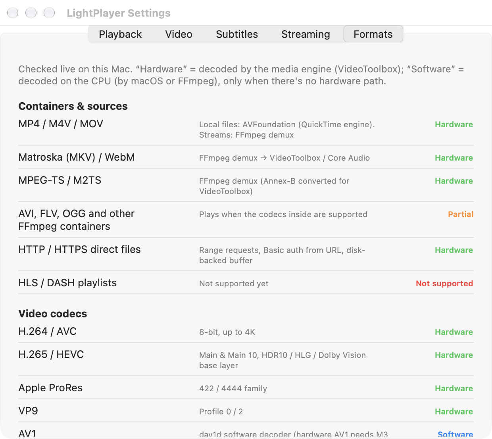

# LightPlayer

A low-RAM, hardware-accelerated video player for macOS 27+ on Apple silicon.


 

Press **⌘I** for the inspector: pipeline, decoder actually in use (VideoToolbox hardware / software, dav1d, FFmpeg audio, or a Media Extension), colour/HDR, tracks, file info and live status (buffer, disk cache, download speed, memory, CPU, display EDR headroom).

## Build

```bash
brew install ffmpeg xcodegen   # mpv only needed for the LightBench target
Bench/build.sh                 # builds build/Build/Products/Release/LightPlayer.app
SCHEME=LightBench Bench/build.sh
```

## Architecture

| Source | Engine | Why |
|---|---|---|
| Local MP4 / M4V / MOV | `AVPlayerEngine` — AVFoundation (QuickTime's stack) | Leanest index memory for long MP4s |
| Everything else (MKV, WebM, TS, AVI…) and **all** network streams | `SampleBufferEngine` — libavformat demux only → `AVSampleBufferDisplayLayer` / `AVSampleBufferAudioRenderer` | VideoToolbox/Core Audio decode; same RAM as AVPlayer; disk-backed stream buffer |

- No decoded pixels ever touch app memory; compressed packets are copied into a `CMMemoryPool` and freed immediately.
- Streams go through `CachedHTTPSource`: ranged HTTP downloads into a sparse temp file (default 10 min read-ahead, Basic auth from URL), so the buffer lives on disk, not RAM.
- Brightness / contrast / gamma are Core Image layer filters, attached only when non-default (HDR is shown as SDR while a filter is active).
- Subtitles: SRT / WebVTT / mov_text / ASS-as-text and PGS / VobSub / DVB bitmaps, embedded or sidecar; hidden by default unless a forced track exists (MKV disposition, ffmpeg's MP4 `udta/kind` "forced-subtitle" box, or Apple's tx3g forced display flags).
- In-app hardware decoding (engine C): compressed H.264/HEVC/VP9 go through our own pipelined `VTDecompressionSession` (`HWVideoDecoder`, 4 frames look-ahead + reorder window) and the display layer only presents finished frames. Measured on screen on a 4K HDR10 remux (4K HDR10, 50 Mbps, 8-deep B-pyramids): letting AVSampleBufferDisplayLayer decode internally showed only 194–222 distinct frames per 12 s (it silently repeats ~25–35% of frames, while its own metrics report ~no drops) — that was the "jitter" IINA doesn't have. With in-app decoding: 299–301 distinct frames (all of them), a clean 2-3 cadence. Cost: ~+17 MB total. `LP_LAYER_DECODE=1` reverts; `LP_VIDEO_METRICS=1` logs the renderer's counters (also in the inspector).
- HDR on/off (brightness popover and Settings › Video): off tone-maps HDR10/HLG to SDR — engine C asks VideoToolbox to output BT.709 8-bit while decoding (decoder is rebuilt and the current frame re-shown when toggled), AVPlayer gets a BT.709 video composition. Verified with HDR screen captures of a PQ grey ramp: on = highlights at 2.0× SDR white (same as QuickTime), off = capped at 1.0.
- Full screen covering the camera notch (Settings › Video): macOS full screen keeps the strip beside the notch black; this option uses a borderless screen-sized window with auto-hiding menu bar and Dock instead (only on displays with a notch).
- Display sync (engine C): 23.976 / 29.97 / 59.94 fps on a 60 Hz panel drift ~1 ms/s against vsync, so frames periodically sit on a refresh boundary and flip between refreshes (3-3-2-2 judder). The audio clock runs at refresh/(n·fps) (e.g. ×1.001 → exact 24.000 fps; varispeed audio, inaudible). The video layer gets its **own timebase at exactly 1× host time** (timestamps scaled by 1/s), slaved to the audio clock with a few ms of A/V offset chosen so frames sit ¼ refresh from any boundary — measured on screen, AVSampleBufferDisplayLayer paces frames 2-2-2-4 whenever its timebase rate isn't exactly 1, and a feedback loop on the shared clock oscillated (every rate change re-anchors the audio clock). Measured with `Bench/cadence.swift` (ScreenCaptureKit, compile with `swiftc -O`) on a constant-motion 23.976 fps clip: 0 cadence breaks in ~470 frame pairs per 20 s (sync off: 5–9; previous rate-locked version: 13–18; IINA: 33–37 per 8 s). Shown in the inspector's Status tab; `LP_NO_DISPLAY_SYNC=1` disables, `LP_SYNC_DEBUG=1` logs phase/A-V.
- Auto-crop black bars (letterbox / pillarbox / windowbox): a few on-screen frames are converted on the GPU (VTPixelTransferSession — hardware decoders output lossless-compressed `&8v0`/`&xv0` surfaces) to a 640 px NV12 thumbnail and scanned inward from each edge; a line counts as a bar only if it is uniformly near-black. Crops once two samples agree, never more than the least-cropped sample; window reshapes to the cropped aspect; image subtitles in the bars are pulled into view. Toggle with **C**. The decision is remembered per file, so re-opening applies it instantly without re-detecting.
- Timing: Matroska stores timestamps rounded to 1 ms. Audio buffers are chained sample-accurately (no ±1.7 ms gaps → no crackle) and video timestamps are snapped to the exact frame grid (e.g. 24000/1001; encoder quirks like 29999/1200 → 25), so 23.976 fps keeps a steady 3:2 cadence on 60 Hz displays. `LP_AUDIO_DEBUG=1` / `LP_VIDEO_DEBUG=1` print continuity stats.
- Software fallbacks (only when there is no hardware/system decoder): DTS / DTS-HD MA (lossless by default), TrueHD, Vorbis, WMA → FFmpeg → Float32 PCM; AV1 on M1/M2 → dav1d → pooled IOSurface NV12/P010 buffers; VP8/VC-1/etc. → FFmpeg. Decoding happens only when the renderer asks for data, so decoded frames never pile up.

| Fallback (M2) | App RAM | CPU |
|---|---|---|
| AV1 1080p30, dav1d (`max_frame_delay` 1) | 72 MB | 23% |
| AV1 1080p30, dav1d (delay 2 / auto) | 100–109 MB | 32–33% |
| DTS-HD MA 5.1 lossless on 4K HEVC remux | 52 MB (+207 MB decoder process) | ~8% total, decode itself barely shows in samples |

## Benchmark (M2, 1280×720 window, app + VTDecoderXPCService footprint)

| Clip | A AVPlayer | C FFdemux+AVSBDL | D libmpv |
|---|---|---|---|
| 1080p H.264 MP4 | 103 MB · 9% CPU | 102 MB · 9% | 339 MB · 30% |
| 4K HDR HEVC MP4 | 252 MB · 6% | 252 MB · 6% | 876 MB · 19% |
| 4K HDR HEVC MKV | — | 240 MB · 7% | 877 MB · 19% |
| 4K remux MKV 9 GB (DTS) | — | 235 MB · 5% | 1055 MB · 17% |
| 1080p MP4, 4.5 h, 15 GB | **136 MB** | 192 MB | 438 MB |
| Remote HTTPS 1080p MKV | — | 80 MB · 6% | 331 MB · 18% |

### Engine B: AVPlayer + Media Extensions (QuickLook Video)

Our own Matroska reader (`Sources/MKVReader`) can't load without a paid-team entitlement, so engine B uses
[QuickLook Video](https://github.com/Marginal/QuickLookVideo)'s signed format reader + video decoder extensions
(install the app, enable *QLVideo Formats* / *QLVideo Codecs* in System Settings › Media Extensions). The app calls
`MTRegisterProfessionalVideoWorkflowFormatReaders()` + `VTRegisterProfessionalVideoWorkflowVideoDecoders()` to opt in.

| Clip (total RAM, first frame) | B AVPlayer + QLVideo | C built-in |
|---|---|---|
| 4K HDR HEVC MKV | 353 MB · 1.9 s | **246 MB · 0.08 s** |
| 4K remux MKV (DTS-HD MA) | 355 MB · 2.1 s | **267 MB · 0.07 s** |
| Remote HTTPS 1080p MKV | 101 MB · 7.1 s, 47% CPU, dropped frames | **122 MB · 0.47 s** (incl. disk buffer fill) |
| VP9 / AV1 / DTS short clips | stalled after accurate seeks | played through |

B is available as an opt-in setting (Playback › Engine) and falls back to C automatically if the extension fails.

Re-run: `Bench/run_bench.py --seconds 40` (remote URL read from `Bench/.remote_url`, not committed).
